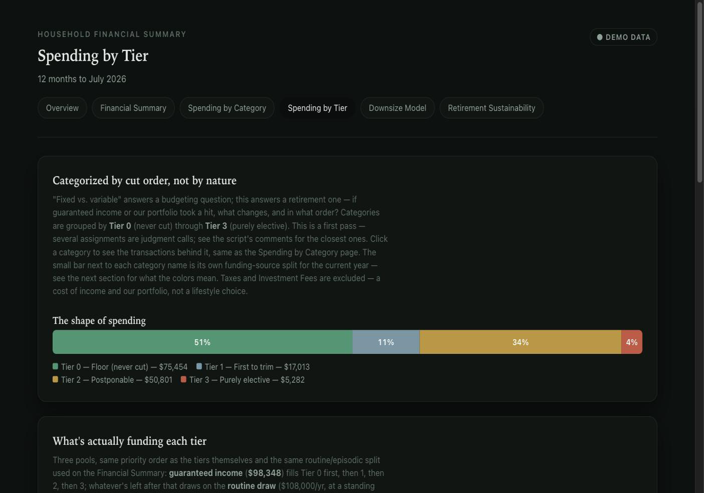
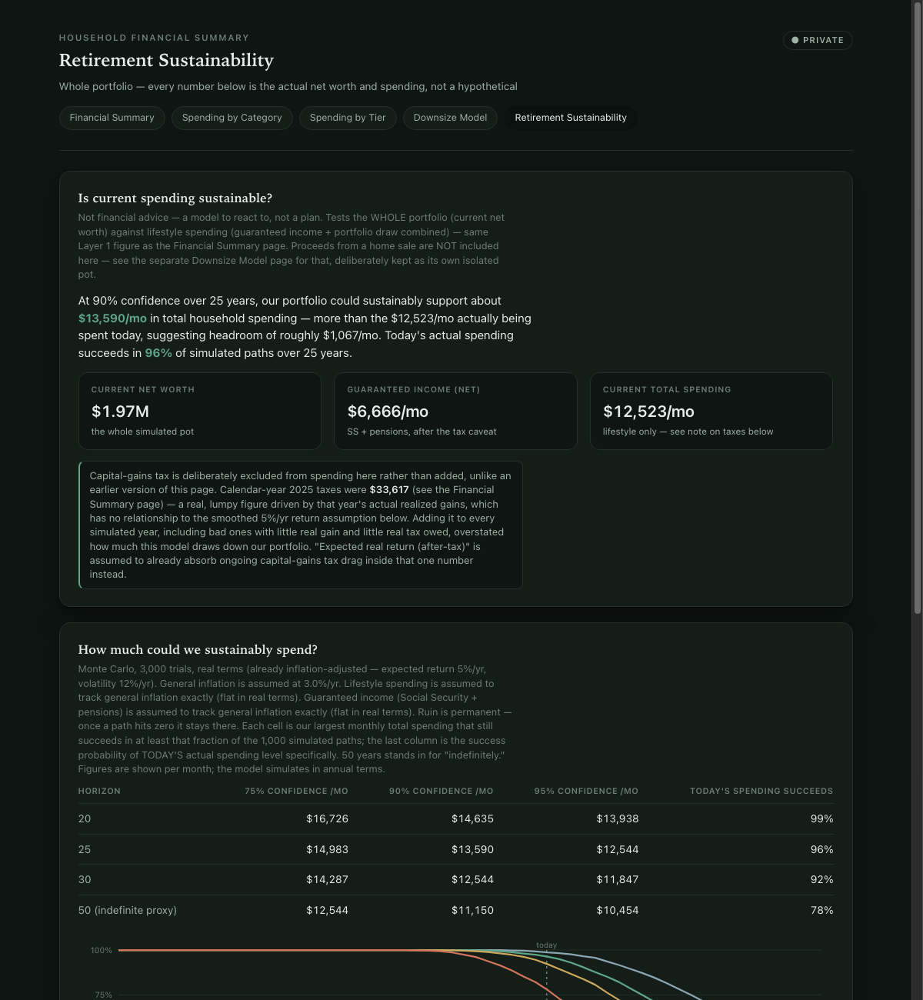

# Tiller Runway

A retirement/cut-order budgeting toolkit built on Tiller.

Five interactive HTML reports and a shareable PDF summary, all generated from a
[Tiller](https://tiller.com) Google Sheet — built around a retirement-drawdown question, not a
corporate-budget one: **if guaranteed income or the portfolio took a hit, what changes, and in
what order?**

**[Live demo →](https://your-github-username.github.io/tiller-runway/)** &nbsp;·&nbsp;
**[Sample PDF →](docs/advisor_summary.pdf)** &nbsp;·&nbsp;
**[Sample sheet →](https://docs.google.com/spreadsheets/your-sheet-id)** (view-only — see below)

*(Replace the three links above with your actual GitHub Pages URL and sheet URL once those are
live — see the note at the bottom of this file.)*

All figures on the live demo, in the sample PDF, and on the sample sheet are fabricated data for
a made-up household ("Alex & Jordan") — see
[`scripts/generate_demo_data.py`](scripts/generate_demo_data.py). The sample sheet is shared
**view-only** and isn't kept in sync with anything — it's a one-time snapshot, not a live feed.
Use **File → Make a copy** to get your own editable copy to build from (see
[`SETUP_GOOGLE_SHEETS.md`](SETUP_GOOGLE_SHEETS.md)).

**Not financial, tax, or legal advice.** Every figure here is a model output based on assumptions
you control — verify independently before making any real decision. Provided as-is, with no
warranty; see [`LICENSE`](LICENSE).

## What's here that you won't find in a typical Tiller dashboard

1. **Cut-order tier budgeting.** Every spending category is tagged Tier 0 (floor, never cut)
   through Tier 3 (purely elective) on the sheet itself, and a funding-source waterfall shows
   exactly which pool — guaranteed income, routine portfolio draw, or episodic draw — is paying
   for each tier, in priority order.

   

2. **A downsize/sale-to-rent Monte Carlo model.** "If we sold the house today, could the invested
   proceeds sustainably cover rent?" — with a real mortgage-interest/property-tax tax-benefit
   calculator netted against the raw cost of owning, not just a rule-of-thumb comparison.

3. **A whole-portfolio retirement-sustainability model**, a different question from #2: given
   your *entire* net worth plus guaranteed income, what can you actually sustain spending,
   at what confidence level, over 20/25/30/50-year horizons?

   

4. **A separate, aggregate-only PDF generator.** The interactive pages embed full per-category
   transaction detail for click-to-expand charts — great for you, not something to hand a third
   party. `render_advisor_pdf.py` builds an 8-page PDF from rollups only (net worth, tier
   composition, bucket totals) — no individual transaction ever appears — safe to send to a CPA
   or financial advisor.

Every assumption (tax rates, Monte Carlo trial count, inflation, LTCG rate, ...) lives in an
editable cell on the Google Sheet, never hardcoded in the scripts — change a number, re-run, done.

## Quickstart (using the synthetic demo data)

```bash
git clone https://github.com/your-github-username/tiller-runway.git
cd tiller-runway
python3 -m venv .venv && .venv/bin/pip install -r requirements.txt
```

Then set up a Google Sheet and share it with a service account — see
[`SETUP_GOOGLE_SHEETS.md`](SETUP_GOOGLE_SHEETS.md) for the walkthrough (it's a one-time thing; a
service account can't create its own sheet, so you make a blank one and share it). With only
synthetic data involved at this stage there's nothing sensitive to worry about yet, but the doc
also covers exactly what "sharing a sheet with a service account" does and doesn't expose, worth
reading before you ever point this at real data — see **Security** below.

```bash
.venv/bin/python3 scripts/generate_demo_data.py   # fabricates 3 years of synthetic household data
./run_demo.sh                                     # renders all 6 reports
open reports/dashboard.html                       # or reports/advisor_summary.pdf
```

## Using your own real data

**Heads up: this doesn't just plug into a stock Tiller sheet.** Some of what's read here is
native to Tiller (Transactions, the base Categories columns, Accounts, Balance History); some of
it — the `Bucket`/`Tier` columns on Categories, and the entire `Downsize Model` and `Portfolio
Model` tabs — is custom structure the original household built by hand, with no Tiller feature
behind it. `SETUP_GOOGLE_SHEETS.md` has the exact column/tab specs to add to your own sheet, plus
which scripts work against a stock sheet as-is versus which need the custom pieces first.

Once those exist: copy `scripts/config.py` to `scripts/config_local.py` (gitignored) and set
`HOUSEHOLD_NAME`, `SHEET_ID`, your real guaranteed-income category names, and your own
tax-rate assumptions — `render_*.py` never needs to change — then re-run `./run_demo.sh`.

## Security

Sharing a real Tiller sheet with a service account is low risk *if* the credential is handled
carefully — the sharing itself only grants access to that one spreadsheet, nothing else in your
Google account. The actual risk concentrates in the downloaded JSON key file, which is a
long-lived credential, not a login — anyone holding it can act as the service account until it's
revoked. This repo also connects by spreadsheet ID rather than searching Drive by name, so the
credential only ever requests the narrow `spreadsheets` scope, never `drive`.

Full explanation, plus the two independent ways to revoke access if anything goes wrong, in
**"Understanding the security model"** in [`SETUP_GOOGLE_SHEETS.md`](SETUP_GOOGLE_SHEETS.md#understanding-the-security-model)
— read it before pointing this at anything real.

## What's not included

This is the reporting/modeling layer, not the full private toolkit it's drawn from — bank-import
scripts, one-off data-fixup scripts, and an operations runbook are specific to the original
household's setup and aren't part of this repo.

## Publishing your own copy

`docs/` is a committed, ready-to-serve copy of the demo output (the same six reports, plus the
sample PDF) — turn on **Settings → Pages → Deploy from branch → main /docs** on your fork and
it's live with no server. `run_demo.sh` writes to `reports/` (gitignored, scratch output); copy
whatever you want published into `docs/` the same way this repo's own copy was made.

## License

MIT — see [`LICENSE`](LICENSE).
